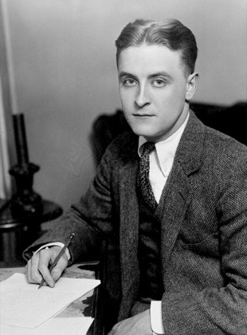
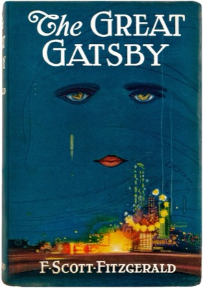

# Book Club: The Great Gatsby

A reading companion for the mChatAI book club. Read a chapter, then open **Book Club: The Great Gatsby** in the mChatAI app and talk it over with a host who only ever discusses as far as you've read.

## About the book

F. Scott Fitzgerald published *The Great Gatsby* on 10 April 1925 with Scribner's. The novel is set in the summer of 1922 on Long Island, in the fictional towns of West Egg and East Egg, and in New York City. It sold modestly in Fitzgerald's lifetime; the revival came after the Second World War, when a cheap Armed Services Edition went out to soldiers and the book entered school reading lists. It has nine chapters and about 47,000 words — a chapter is twenty to thirty minutes of reading.

## Read and listen, free

- [The text on Project Gutenberg](https://www.gutenberg.org/ebooks/64317) — read online, or download EPUB or Kindle files.
- [LibriVox recordings](https://librivox.org/search?q=the+great+gatsby&search_form=advanced) — free audiobooks read by volunteers.
- [The Great Gatsby on Wikipedia](https://en.wikipedia.org/wiki/The_Great_Gatsby) — background, publication history and reception. (The plot summary spoils the ending.)
- [F. Scott Fitzgerald on Wikipedia](https://en.wikipedia.org/wiki/F._Scott_Fitzgerald) — the author's life.

## Talk about it

- [r/books on Reddit](https://www.reddit.com/r/books/search/?q=%22great+gatsby%22) — reader threads, old and new. Threads often discuss the whole book.
- [Goodreads](https://www.goodreads.com/book/show/4671.The_Great_Gatsby) — reviews and reader ratings.

## Questions, chapter by chapter

Each chapter's questions are folded away so you only open the ones you've reached.

### Chapter 1

- Nick introduces himself before anyone else. What does he want you to think of him, and do you?
- Compare the two houses you visit in this chapter. What does each say about its owners before anyone speaks?
- The chapter ends with a figure on a lawn and a light across the water. Why end there?

### Chapter 2

- The valley of ashes comes right after the lawns of East Egg. What is the book doing with that order?
- Myrtle and Daisy never meet in this chapter, yet both are present at the apartment party. How?
- Nick says he was drunk. How much does that change what you trust in his account?

### Chapter 3

- Most guests at the party were never invited. What kind of host wants that?
- The owl-eyed man is amazed the books are real. What is he really checking?
- Nick calls himself one of the few honest people he knows. Is this chapter evidence for or against that?

### Chapter 4

- Gatsby's story of his life changes as he tells it. Which parts do you believe, and why those?
- Meyer Wolfsheim is in the book for one lunch. What does he add that Gatsby alone could not?
- Jordan tells the Louisville story. Why does the book give it to her rather than to Gatsby or Daisy?

### Chapter 5

- The clock nearly falls. What else is Gatsby trying to hold up in this scene?
- Daisy cries over the shirts. What is she actually crying about?
- Nick says the green light has lost something by being reached. Has anything in your own life worked that way?

### Chapter 6

- We learn Gatsby's real origins here, out of order. Why does Nick choose this moment to tell us?
- Tom calls Gatsby a bootlegger. Does it matter to Daisy whether it's true?
- "Can't repeat the past?" Gatsby thinks you can. Who in your own reading has tried?

### Chapter 7

- Why does the book put its longest, hottest day in a hotel room?
- Whose version of the accident do you believe, and what does each person choose not to say?
- Tom and Daisy at the kitchen table: what do you imagine they agreed?

### Chapter 8

- Gatsby finally tells Nick about Louisville. Why now, and why only to Nick?
- Nick pays Gatsby his one compliment. Is it a compliment?
- The eyes of Eckleburg return. What has Wilson decided they mean, and what do you think they mean?

### Chapter 9

- Who comes to the funeral, and who doesn't? What does the guest list say about the whole summer?
- Nick shakes Tom's hand anyway. Should he have?
- The last paragraph reaches back to the first sailors. How does the ending change the way you read chapter 1?

---

Pictures are public domain via Wikimedia Commons. The book itself is in the public domain in the United States.
